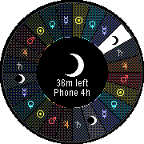

# Planetary Hours for Pebble



A Pebble watchface for the old system of planetary hours. Daylight and night
are each split into twelve parts, so the hours stretch and shrink with the
seasons. Each hour has a ruler, and the rulers cycle through the seven
classical planets in Chaldean order. A planetary day starts at sunrise, so the
hours before dawn still belong to the previous day.

[Get it on the Pebble Appstore](https://apps.repebble.com/f55150897544461abccac7ea).
Version 0.1.2 runs on Pebble Time and Time Steel (Basalt), Pebble Time Round
(Chalk), Pebble 2 (Diorite), Pebble Time 2 (Emery), Pebble 2 Duo (Flint) and
Pebble Round 2 (Gabbro).

## Reading the face

On round watches, a wheel of 24 equal wedges carries the planetary symbols.
The right half is daylight and the left half is night. The wedges are equal on
screen, but the hours they stand for are not. The current hour is highlighted,
and the center shows the ruling planet and the minutes left in its hour,
rounded up.

On rectangular watches, two columns of twelve symbols replace the wheel:
daylight on the left, night on the right. The current ruler, minutes left and
location age sit in the middle.

Color watches use the palette of the original web clock, with a fixed dither
on the dark wedges. Black-and-white watches draw the symbols in white, with
the current hour inverted. The symbols are drawn with lines and
circles, so no font is downloaded. The face redraws once a second.

## Location

The face needs your phone's location to find sunrise and sunset. The phone
asks for a low-accuracy position when the companion starts and when the watch
asks for a refresh: at startup, on reconnection and every hour. If the watch
has no usable schedule, it retries while connected, a minute apart for the
first three tries and then every five minutes.

The phone saves the last good position and its timestamp, and falls back to it
if a later request fails. Only sunrise and sunset times, the weekday, the age
of the fix and a status code go to the watch. Coordinates stay on the phone,
and no server receives them. There is no default city.

A small label shows where the schedule came from and how old the fix is:
`Phone 2m`, `Saved 3h` or `Stale 1d`. A fix becomes stale after six hours.

The phone sends the current sunrise-to-sunrise cycle and up to two more, so
the watch keeps working offline for a while. The watch checks the whole
message before it replaces its saved schedule. When the last sunrise it knows
about has passed, it stops showing a ruler and asks for a refresh.

With no location the watch says `Needs phone`. Permission denied, timeouts,
bad fixes and unavailable location each have their own label. Polar day,
polar night and a missing sunrise are shown as conditions; the face does not
invent twelve-hour periods for them. On a round watch, `No cycle` means a full
sunrise-to-sunrise cycle could not be calculated.

The solar equations come from my original web clock. Events are UTC instants,
and the planet order uses the phone's local weekday at the sunrise that starts
each cycle, which handles midnight, daylight saving time and the date line.
The phone's time zone must match where you are. The calculation does not
account for terrain or unusual atmospheric refraction.

## Build and test

You need Pebble SDK 4.33.1 with the `pebble` command-line tool, Node.js, and a
C compiler with AddressSanitizer and UndefinedBehaviorSanitizer. The menu icon
PNG is checked in; ImageMagick is only needed to regenerate it from the SVG.

```sh
make build
make icon  # optional: regenerate the 25×25 menu icon
```

`make build` runs `make test` first: native boundary and decoder tests, 907
comparisons against the original solar code, and 26 mocked phone scenarios.
The solar tests cover both hemispheres, daylight saving time, leap day, year
rollover, the date line, polar transitions and invalid input. After the build
it also runs the bundled phone companion's entry point.

Packaging and emulator checks use the Python environment installed with
`pebble-tool` (it includes `libpebble2` and `pypng`):

```sh
python test/package.py
python -m unittest discover -s test -p '*_test.py'
python test/emulator.py chalk --fresh
python test/package.py --evidence build/evidence
python test/source-rebuild.py
```

`--evidence` needs emulator captures for all six watches and builds a PBW and
source ZIP. `test/source-rebuild.py` unpacks that ZIP in a new folder, builds
it again and compares the native code, resources and phone code. The emulator
check installs the production PBW with location fixtures, so it does not use
your real location.

To print the schedule and `DATA` payload for a test position:

```sh
TZ=America/Los_Angeles node test/fixtures.js 2026-09-06T06:12:00Z 37.7749 -122.4194 stale
```

Those coordinates are a test fixture, not a fallback the face uses.

`release/` holds the 0.1.0 and 0.1.1 packages, source archives and rebuild
records. The screenshots in `evidence/` come from 0.1.1, before the
rectangular layout changed to two columns. Build logs in earlier commits and
the release archives contain absolute paths from the original build machine.

## Message format

UUID `70cc559e-2c8d-4b47-acec-46f1dce646c8`. Keys: `REQUEST=0`, `DATA=1`.
`DATA` is one 72-byte little-endian byte array, schema version 1.

| Offset | Field |
| --- | --- |
| 0–3 | Four bytes: version, status, location mode, error |
| 4, 8, 12 | Unsigned 32-bit generation time, original fix time, validity end |
| 16 | Signed 32-bit phone time zone offset in minutes, JavaScript convention |
| 20 | Unsigned 32-bit cycle count, zero to three |
| 24, 40, 56 | Four unsigned 32-bit fields per cycle: sunrise, sunset, next sunrise, Sunday-based weekday |

Status: 1 normal, 2 polar day, 3 polar night, 4 no complete solar cycle,
5 no location. Mode: 0 none, 1 phone, 2 saved. Error: 0 none, 1 denied,
2 unavailable, 3 timeout, 4 invalid fix. Unused cycle slots are zero.
Non-normal records carry no cycles and expire after six hours.

## Source

I made the original [Planetary Hours](https://datapoems.io/clocks/planetary-hours/)
clock for the web. Its HTML is kept in `reference/` for comparison; the watch
does not load it. See [reference/README.md](reference/README.md) for what the
port keeps and changes.

## License

MIT. See [LICENSE](LICENSE).
